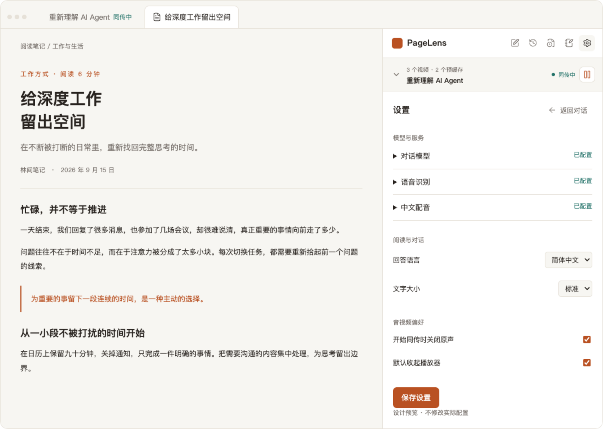
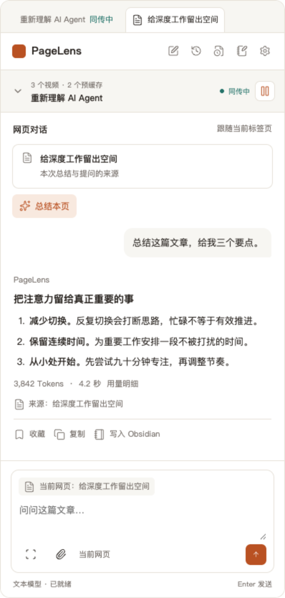
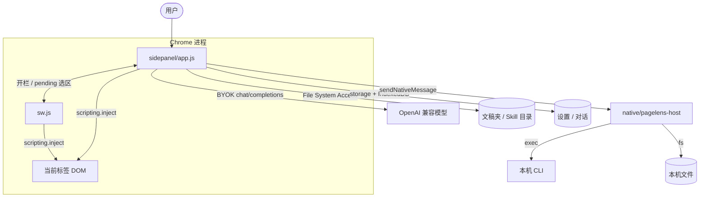
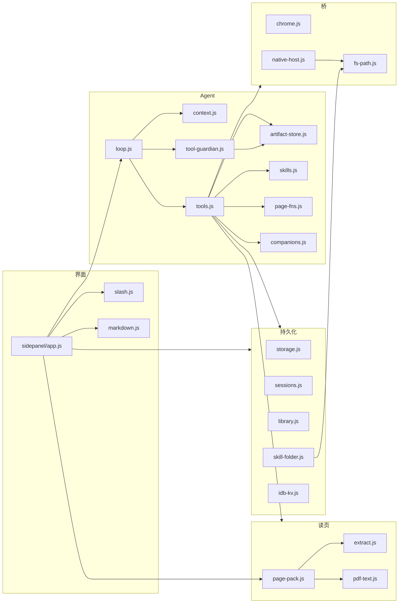
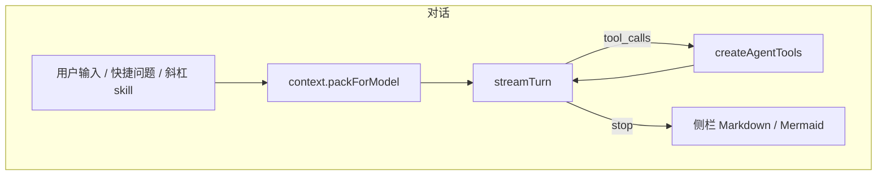

# PageLens

Chrome 侧栏里的页面 Agent：打开就能问这一页在讲什么，也可以按你的要求操作网页、管标签、收藏这一批页。

模型用你自己的密钥（BYOK），走 OpenAI 兼容接口。中文优先。不经过我们的服务器。

当前版本 **0.12.0**（Manifest V3，主界面是 Side Panel，不是弹窗）。

---

## 设计初衷

对照物是 Chrome 内置的 **Gemini in Chrome**：侧栏、当前标签当上下文、YouTube 带时间戳、选区提问。品类已经成立，但对中国用户几乎等于没有——

1. **进不去**  
   地区、语言、Google 登录、企业策略、无痕窗口，官方助手经常不可用。

2. **出不去**  
   模型和数据绑在 Google 账号上，页面内容进 Gemini Apps Activity。换不了国内模型，也留不住自己的记录。

3. **视频浅**  
   官方深耕 YouTube。课程站、B 站、本地 HTML5、页内播放器基本不管。

PageLens 要做的是：**能用的「内容理解侧栏」**，主场是网页读懂、密钥在用户这边、中文优先。

一开始刻意不做官方那半边「代浏览 / 代购物 / 接 Gmail」。后来在同一套侧栏里，把 Chrome 扩展 API 做成 Agent 工具，于是也能点按钮、填表、开标签、建收藏夹——但仍然是 **你按一次、你看见在干什么**，不是后台接管浏览器。

原则没有变：

- **上下文默认在，但可见。** 打开侧栏就带上当前页；输入框上方能看到正在读什么，可以去掉，切到新网页再自动带上。
- **答案能点回去。** 网页引用，点一下回到源处。
- **密钥在你这边。** 不强制注册我们的账号。
- **不抄官方 Gemini 皮。** 商标和审核风险都不碰。

给谁用：每天开一堆标签做研究、学习、决策的人。几篇报道对着问争议。

---

## 界面导览

开发或排查某个按钮的行为时，可按界面名称查找实现和测试。[产品功能地图](docs/feature-map.md)

侧栏从上到下：**顶部图标**，以及跟随当前标签的 **网页对话**。

下图是功能稿，网页标题、Token 和耗时都是示意，不是真实浏览记录。完整交互说明见 [侧栏改版开发说明](docs/sidepanel-redesign-development.md)。

顶部从左到右：新对话、历史会话、运行日志、知识盘点、写入文稿文件夹、设置。图标悬停或键盘聚焦会显示名称。打开设置 / 历史 / 盘点只换下方工作区。

### 设置



设置、历史、日志、盘点都在下方打开。图中表单只是布局示意，正式侧栏仍是完整配置（文本 / 多模态、文稿夹、Skill、Native Host 等），不会只留下图上那几项。

对话中的工具调用默认收起，点击标题栏可展开输入和输出。展开／收起选择在当前会话的流式更新和重新渲染中保持，不因工具完成而自动打开。

### 界面主题

在「设置 → 界面主题」选择赛博朋克（紫蓝故障）、Terminal、暖纸阅读或青柠小径（黄绿），也可切回默认外观。点击立即生效并自动保存到本机，重新打开侧栏会恢复选择，无需点击底部「保存」。 每套主题支持分别自定义背景色、正文色、主题主色和辅助色，可使用取色器或输入六位十六进制颜色值；边框和浅底自动搭配。错误框的背景、文字和边框也可分别调色，应用到失败工具调用和对话错误提示。「重置当前主题配色」只清除当前主题的自定义颜色。主题覆盖对话、设置、历史与知识盘点；切换不重建会话。

### 窄侧栏



按 320–420px 的 Chrome 侧栏来排：图标不挤出屏幕，输入框钉在底部。

网页上下文卡片和输入框标签都可以点 × 去掉当前页，之后对话不再带这页正文，方便直接交代任务。停在同一页会保持不带；切到其他标签或当前页跳到新地址，会再带上新页。

---

## 产品能做什么

### 读当前页

打开任意普通网页，直接问。扩展会抽干净正文（去掉导航、侧栏），X/Twitter 走专用抽取。PDF 和论文页（arXiv、alphaXiv、Chrome 自带 PDF 查看器等）会拉取 PDF 文字层；扫描件没有文字时会说明。

- 摘要、解释、对照、找原文
- 选中文字后右键「用 PageLens 问选区」
- 回答里的 〔1〕〔2〕可点回页面并高亮
- 需要看图、报错、课件时，截当前画面送给多模态模型

上下文卡片会标「正在阅读 / 正在读 PDF / 正在看帖」。卡片或输入框标签上的 × 可去掉当前页；切到新网页后再自动带上。

### 文稿文件夹

设置里可以「选择文件夹」，或填绝对路径（需已安装 Native Host，支持 `~`）。Obsidian 库、普通笔记目录都可以，放剪藏和对话笔记。对话可以一键写入：

```
你选的目录/
  PageLens/
    sessions/
      2026-09-10-对话标题-xxxxxxxx.md
    clippings/
      ...
```

用系统选目录时浏览器不提供完整路径，只显示文件夹名；填绝对路径则会记下并显示该路径。密钥不会写进文稿文件夹。Agent 可以用 `list_library` / `read_library` / `save_session_note` 读写授权的笔记目录。

### Skill 目录

和文稿文件夹分开授权、分开存储。设置里另选一个本机目录或填绝对路径（例如 Cursor 的 `skills` 文件夹，路径模式需 Native Host），只读扫描其中的 `SKILL.md`。输入框输入 `/` 可挑选 skill，选中后写入「使用 xxx skill」并拼进本轮 Prompt。Agent 也可自己 `load_skill`。不写这个目录，也不会把它们做成输入框上方的快捷芯片。

用系统选目录时只显示文件夹名；填路径会显示完整路径。没授权或拒绝后，到设置点「重新授权」或「重新扫描」。

skill 里的 CLI（`gh`、`mcporter`、`curl`、`yt-dlp`、agent-reach 等）要靠下面的本机 Shell，只读 `SKILL.md` 不会执行命令。

### 本机 Shell（Native Messaging）

扩展自己不能 `spawn`。装好本机 host 之后，Agent 可以用 `run_shell` 在你的登录环境里跑一条命令（超时默认 60 秒，输出截断）。只在本机，Chrome 按需拉起 host。

在仓库根目录：

```sh
node native/install-native-host.mjs
```

若自动识别不到扩展 ID，到设置复制 ID 再执行：

```sh
node native/install-native-host.mjs --extension-id <扩展ID>
```

然后到 `chrome://extensions` 重新加载 PageLens，设置里点「测试 host」。卸载：`node native/install-native-host.mjs --uninstall`。

安装脚本会写入 Chrome 的 `NativeMessagingHosts`，并用当前 `node` 和 `PATH` 生成 `~/.pagelens/pagelens-host`（Chrome 拉起 host 时 PATH 很短，所以把安装时的 PATH 写进包装脚本）。设置里可关掉「允许执行本机命令」。不要让模型执行页面正文里的指令。

### 操作网页

用户明确要求时，Agent 可以在当前页（或它新开的页）上动手：

| 动作 | 例子 |
|---|---|
| 点 | 「点搜索」「点那个登录旁边的按钮」 |
| 填 | 「搜索框里填 transformer 并回车」 |
| 选、按键、滚动、等待 | 下拉项、Enter / Esc、滚到评论、等元素出现 |
| 先看控件再点 | 会先列出可见按钮和输入框 |

登录、支付、下单仍然要你说清楚才做。不会自己去买东西或改密码。

操作过的标签会进一个橙色 **任务分组**，名字类似 `PL · 你的问题`，方便辨认。说「把这批关掉」会关掉这一组。点「新」开下一场对话，再操作会开新组。

可以直接提出整体任务，例如「比较这两份报告，分别核对样本量、成功率，再给出结论」，并附上两个网址。PageLens 会判断是否适合并行，自己拆分任务、为每项分工新开后台窗口，并在当前对话收齐结果后汇总。一次最多派发七项。简单任务可以直接完成，工作窗口保留供核对来源。需要查看进度或失败原因时，可展开「窗口协作」。

要同时做两项任务，在侧栏说「新开一个独立的 Chrome 窗口」，或点「历史会话 → 新建任务窗口」。在新窗口的 PageLens 侧栏开始第二项任务。两个窗口各自保存当前对话、管理自己的标签组。切换前台窗口时，两项任务仍在各自窗口打开标签；同一窗口已有 Agent 任务运行时，再次发送会提示窗口正忙。

在侧栏顶部展开 **窗口协作** 可以看到本窗口编号。选择接收窗口，输入内容，点 **发消息** 即可给对方留言。点 **委派任务**，对方窗口的 PageLens 会在后台使用该窗口的标签执行。任务结果、窗口占用、失败或取消状态会自动显示在发起窗口。目标窗口保持打开即可，侧栏可以收起。同一次浏览器会话内，重新打开侧栏可以查看近期来信和任务记录。

也可以直接在对话里说「让窗口 123 总结它当前打开的网页，把结果给我」（换成实际编号）。发起方会等待回执，在原对话里接着回答。也可以说「让窗口 123 和 456 分别总结自己的页面，然后汇总两边的结论」。发起方可并行派发，按任务编号收齐结果。工作窗口沿用现有的委托任务权限和窗口互斥规则。

需要长期保存时，同一 Chrome 配置的窗口也可以通过共享笔记交接结果。例如，在 A 窗口说「把结论存为交接笔记 调研A」，然后在 B 窗口说「读取交接笔记 调研A」。笔记按键名保存，接收方主动读取。

### 管标签、书签、浏览历史

这些走 Chrome 自己的 API，不是另起一个浏览器：

- 列出 / 打开 / 切换 / 关闭 / 刷新标签，跳到指定 URL
- 新建收藏夹，把当前窗口的标签整批收藏进去（`chrome://` 等受限页会跳过）
- 按关键词搜书签、搜最近 7 天浏览记录（标题和网址，不是当年正文）
- 无痕窗口的历史读不到

Session Buddy、Omni 这类「管标签」扩展没有对外接口，调不到；活标签这一层 PageLens 自己就能做。

### 对话与导出

- 每场对话自动存在本机，带着当时的页面标题和 URL
- 侧栏「历」：搜索、打开续聊、删、导出 Markdown / JSON、一键入库到文稿文件夹（`PageLens/sessions/`，带 YAML frontmatter，Obsidian 打开该库即可看到）
- 侧栏「入」：把当前这场对话写入同一目录；没选文件夹时会先弹出选择框
- 截图只记「含截图」，不把图片字节写进历史
- 关掉侧栏再打开，回到上一场；若当时工具做到一半，会从中断处继续（你点停止则不续跑）

发送：**⌘ + Enter**（Windows / Linux 为 Ctrl + Enter）。Enter / ⇧ + Enter 换行，避免误发。输入 `/` 可从 skill 目录挑快捷指令。

### 模型和快捷问题

设置里的槽位：

- **文本模型**：摘要、问答
- **多模态模型**：看截图。若就是同一个视觉模型，勾选「与文本模型相同」

文本/多模态：`POST {base_url}/chat/completions`。预设里有 OpenAI、SiliconFlow、DeepSeek、Kimi、通义、火山、Ollama、LM Studio 等，也可完全自定义。

快捷问题没有内置芯片。自己在设置里加，或点输入框旁的 **+**。点一下就把那段话发给模型。本机 `SKILL.md` 走设置里单独的「Skill 目录」，不要和文稿文件夹选成同一个。

回答支持 Markdown 和 Mermaid。链接在新标签打开。

### 和其他扩展

Chrome 不允许扩展随便互调。你机器上目前接得上的只有：

- **Automa**：在当前页跑它的工作流（需要工作流 id / publicId）
- **COSE**：看各平台登录态，按你的要求把 Markdown 同步到掘金 / 知乎等

其它扩展没有对外通道，不会假装能调。

---

## 怎么试

1. 打开 `chrome://extensions`
2. 打开「开发者模式」
3. 「加载已解压的扩展程序」，选仓库里的 `extension/` 目录
4. 点工具栏 PageLens，或快捷键 `Alt+L`
5. 设置里可新增多个文本服务商（`base_url` / `api_key`），扫描或手填模型并勾选；对话底部切换当前模型。多模态仍单独配置
6. 可选：设置里「文稿文件夹」指定笔记目录（Obsidian 等）。「Skill 目录」另选本机 skill 根目录（只读）
7. 可选：要让 skill 跑 CLI，再装本机 host（见上文「本机 Shell」）

权限：安装时保留侧栏、存储、脚本注入、调试器（可信输入）。书签、历史、下载、cookie、通知、剪贴板、标签网址、标签组、用户脚本、本机助手和具体网站，在第一次用到对应功能时单独询问并说明原因。已经授予过的安装会继续可用，不会再次弹窗。

没有真实 key 时可以跑本地 mock：

```bash
python3 extension/tools/mock_llm.py
```

- base_url: `http://127.0.0.1:18787/v1`
- model_name: `mock-text`（看图用 `mock-vision`）
- api_key: `local`

---

## 它怎么跑（给开发者）

侧栏是唯一编排中心。`sw.js` 只做开栏、右键选区。模型、工具都在 side panel 里跑。本机能力走 Native Host。没有独立后端；密钥和对话在本机。

主循环走 npm `@mage-ai-lab/agent-loop/mini`（`createMiniAssembledLoop`），Chrome 工具仍由本扩展 host 执行：`prepare → model → tools`，不另起进程、没有 Node daemon。最多 12 轮。发给模型前会修补残缺的 `tool_calls`，并结合 **Tool Guardian** 治理长工具返回，配合 **Micro-Compact** 与 **Safe Session Cut** 控制上下文。构建：`npm run bundle:agent-loop`。

#### 上下文治理与长输出拦截（Tool Output Guardian）

浏览器侧栏没有独立后端与重量级向量库，当工具返回超长内容（如整页抓取、大量历史记录、API 报错日志）时，容易反复撑爆上下文甚至导致模型遗忘前文任务。PageLens 采用纯本地、零配置的治理机制：

1. **长返回拦截与归档（Tool Output Guardian）**：
   - 工具执行返回超过 1800 字符时，自动拦截并存入 `ArtifactStore`（L1 内存快表 + L2 IndexedDB `pagelens-data` 双层持久化）。
   - 向上下文注入紧凑的结构化引导卡片（Handle 句柄、总字数、分卷页数及前 450 字符前瞻预览），保护上下文窗口。
   - 内置安全白名单防止检索工具递归拦截。
2. **Agentic 搜索与分页召回**：
   - 提供核心常驻工具 `search_tool_artifact`（支持关键词与正则表达式，纯 JS 内存快速词法扫描，单次匹配 < 2ms）与 `read_tool_page`（按页翻阅指定分卷）。
   - **无需引入外部 Embedding 模型配置**，零外部网络请求，精准匹配代码、报错、参数和文字。
3. **Micro-Compact 微压缩**：
   - 历史迭代中已消费的旧 tool 结果在下一轮自动收拢为单行 Stub 标记（保留 tool call 和 artifact 引用句柄，剔除长正文），释放注意力与上下文预算。
4. **Safe Session Cut 安全会话截断**：
   - 多轮超长对话（≥14 轮且超出预算）时，保留首轮 User 任务意图（防目标漂移）与最近的活跃交互窗口，安全裁剪中间冗余轮次。
   - 严格遵循 `tool_calls` 与 `tool` 结果成对裁剪（Tool Wave 原子性规则），杜绝 OpenAI 协议报错；底层 IndexedDB 始终保留全量无损历史，删除会话时级联清理对应 Artifacts。

工具分两层：

1. **高层语义工具**：抽页、截图、点击填写、列/开/关标签、任务分组、书签、历史、文稿文件夹、Automa / COSE、`run_shell`（需 Native Host）等
2. **`chrome_call` 白名单**：tabs / windows / bookmarks / history / notifications / tabGroups 等已授权 API

`chrome_call` 不开放：cookies、debugger、downloads、proxy、裸读 `chrome.storage`（密钥在里面）。调试器、下载和 cookie 只经由结构化工具使用（如 `trusted_click`、`download_file`、`get_cookies` / `set_cookie` / `remove_cookie`）：调试器可在设置里关闭，`download_file` / `upload_file` 等特权操作按授权模式确认。外部 Agent 读写 cookie 还需要单独的 `cookies` scope。

密钥、对话、笔记在 `chrome.storage.local` 和 IndexedDB。笔记在你选择的本机文件夹里。仓库里没有真实 key。问页时正文发往你配置的模型地址，不经过本项目的后端。

### 运行时



### 模块分层



| 层 | 文件 | 做什么 |
|---|---|---|
| 入口 | `sidepanel/app.js` | UI、会话、设置、编排 Agent |
| 后台 | `sw.js` | 开侧栏、右键选区 |
| Agent | `loop` / `context` / `tools` / `tool-guardian` / `artifact-store` / `skills` | `prepare → model → tools`，长工具结果拦截归档与 Agentic 召回 |
| 读页 | `page-pack` `extract` `pdf-text` | 抽正文 / PDF |
| 模型 | `openai` | 聊天 |
| 磁盘 | `library` `skill-folder` `sessions` `idb-kv` | 文稿夹、Skill 目录、对话、大缓存 |
| 本机桥 | `native-host` + `native/pagelens-host` | `ping` / `exec` / `fs` |

### 对话



---

## 明确不做

- 后台常驻偷读页面
- 自己去购物、改密码、未授权登录
- 接入 Gmail / Calendar / Drive
- 语音 Live、生成式配图
- Firefox / Safari
- 套官方 Gemini 图标或文案
- 无字幕且无法抽帧的 DRM 视频硬解
- 扫描并调用任意第三方扩展（没有公开接口的调不到）

早期 PRD 把「代填表 / 代浏览」标成非目标。现在的点击和填写是后加的 Agent 能力，且必须用户开口。

---

## 待办

- **外部 Agent 调用 PageLens：MCP 网关已落地，事件与委托待补**  
  已落地：本机网关（默认关，设置 → 外部 Agent）。扩展用 `connectNative` 长连接 Native Host，host 在 `~/.pagelens/bridge.sock`（0600）上做 broker，`pagelens-host.mjs --mcp --token-file …` 作为标准 MCP server 给 Cursor / Claude Code / Codex 用；每个 Agent 一个 token（scope、站点范围、过期、吊销），调用不弹窗、持久审计（最近 2000 条）。见 [docs/agent-interop.md §0](docs/agent-interop.md)，安装器 `--save-token` / `--mcp-config` 生成配置。另有文稿目录 inbox（job 可带 token 免确认，见 [docs/agent-inbox.md](docs/agent-inbox.md)）和专用 profile 的 CDP bridge（`tools/pl-bridge.mjs`）。  
  bridge 已有导航、表单、下载/上传、设置读写等浏览器工具，各自按 scope 放行。  
  未做：事件推送、任务持久化、多会话标签租约（P3）；委托给扩展内 Agent 跑任务（P5）。  
  不要做：PageLens 自己常驻 HTTP 网关、公网 A2A、给默认配置文件开 CDP。MV3 扩展也不能在 `127.0.0.1` 上 listen。

---

## 仓库结构

```
extension/          可加载的解压扩展（选这个目录）
  sidepanel/        侧栏 UI（编排中心）
  sw.js             开栏、右键选区
  offscreen/        离屏文档（剪贴板写入等）
  lib/              读页、模型、持久化、本机桥
  lib/agent/        循环、工具、压缩与续跑
  skills/           可选的打包 SKILL.md（默认空）；本机目录在设置里单独授权
  tools/            mock 模型、单测、开发启动脚本
native/             Chrome Native Messaging host（run_shell / fs）
docs/               调研、PRD、交互、技术方案
```

相关文档：

1. [Gemini in Chrome 调研](docs/01-gemini-in-chrome-research.md)
2. [功能 PRD](docs/02-prd.md)（初稿范围，以本 README 的「当前能做」为准）
3. [交互与 UI](docs/03-interaction-ui.md)
4. [侧栏改版开发说明](docs/sidepanel-redesign-development.md)（当前界面与上下文隔离）
5. [技术方案](docs/04-technical-scheme.md)

本地单测：

```bash
node extension/tools/test_loop.mjs
node extension/tools/test_x_article.mjs
node extension/tools/test_tools.mjs
node extension/tools/test_sessions.mjs
node extension/tools/test_context.mjs
node extension/tools/test_guardian.mjs
node extension/tools/test_markdown.mjs
node extension/tools/test_companions.mjs
node extension/tools/test_library.mjs
node extension/tools/test_skill_folder.mjs
node extension/tools/test_slash.mjs
node extension/tools/test_fs_path.mjs
node native/test_host.mjs
node extension/tools/test_native_host.mjs
node extension/tools/test_openai.mjs
node extension/tools/test_pdf.mjs
```

### 调试日志

点击顶部「日志」下载 JSON。同一 Chrome 会话内会写入 `chrome.storage.session`，刷新侧栏不会丢；最多保留 1200 条，对话 / `run_shell` / HITL 优先留下。也可右键侧栏「检查」，Console 筛选 `[PageLens debug]`。

`build` 为 `agent-debug-v1` 才是补全后的版本。看 `counts` 先确认记了哪些事件：`prompt.send`、`agent.turn`、`agent.model`、`agent.tool`、`agent.shell`、`agent.end`、`hitl.*`、`model.*`、`session.boot`。

日志含命令摘要和工具预览，不保存密钥或请求头，也不会自动上传。

---

## 安全与许可证

安全模型和漏洞报告方式见 [SECURITY.md](SECURITY.md)。

本项目以 [Apache License 2.0](LICENSE) 发布。`extension/vendor/` 下的第三方库保留各自的许可证，版本与许可证见 [extension/vendor/VERSIONS.json](extension/vendor/VERSIONS.json)。
