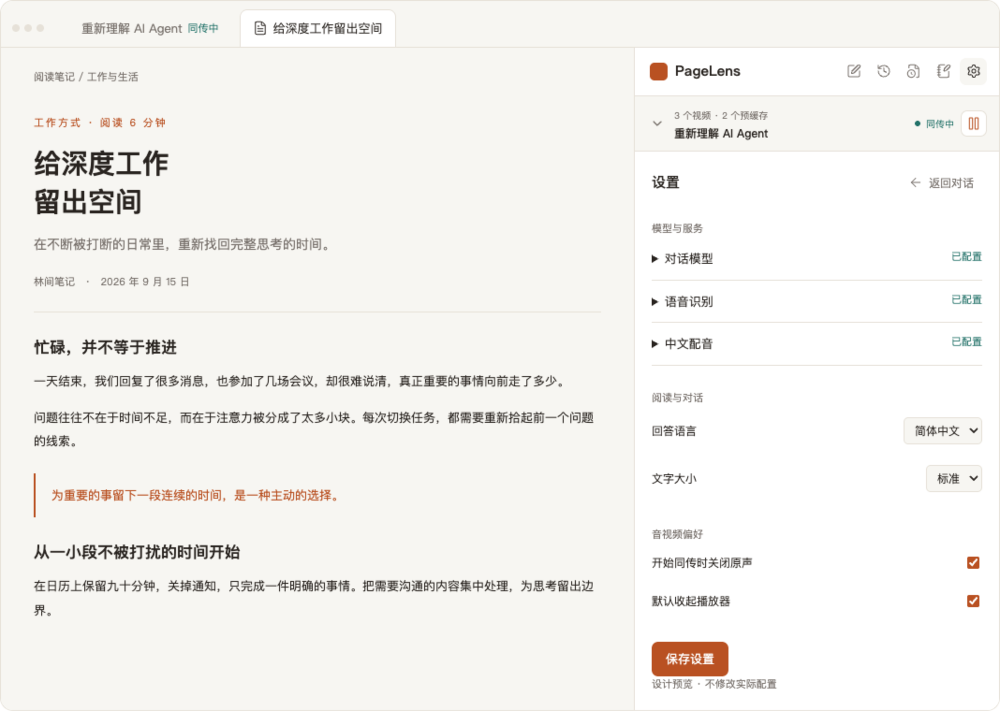
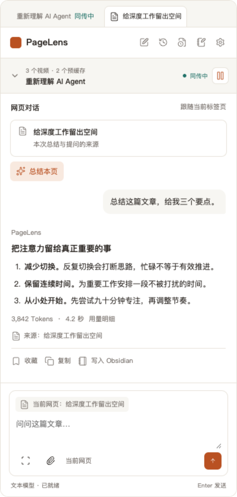

# PageLens 侧栏改版开发说明

- 日期：2026-09-15
- 设计基线：本轮第 4 版交互设计稿
- 状态：待实施。本文和图片用于开发交接；设计稿中的任务、进度、Token 和耗时均为示例，不代表真实服务结果。
- 目标：**对话跟随当前网页。** 打开设置、历史或盘点不覆盖对话草稿。
- 范围：侧栏布局和状态归属。本文不表示这些能力已经实现。
- 原有设计参考：[交互与 UI](03-interaction-ui.md)。涉及本次改版的布局和上下文规则以本文为准。

## 1. 交付物与阅读顺序

1. 先看本节图片，理解设置区与窄侧栏。
2. 阅读第 3–5 节和第 7 节，确认交互、功能迁移和状态规则。
3. 按第 9 节实施，按第 10 节验收。

[可点击交互原型](mockups/sidepanel-redesign/prototype.html)可在浏览器打开。原型不是生产代码：示例按钮只改变本地展示，不调用模型，不修改实际配置。原型图标和提示运行时依赖外部资源；静态 PNG 可离线查看。

### 图 5：全局设置



开发指引：打开设置、历史或盘点只替换下方工作区。图中设置表单仅为布局示意，正式版本必须平迁现有全部配置，不能只实现图上的几项。

### 图 6：窄侧栏



开发指引：主要适配 320–420 CSS px。图标不能挤出屏幕；输入框固定在侧栏底部。展开的列表可以内部滚动，但不能把对话输入框顶到窗口外。浏览器页签和左侧文章仅用于解释场景，不属于扩展实现范围。

## 2. 问题与不可破坏的规则

### 2.1 当前问题

现有 `extension/sidepanel/app.js` 大量逻辑共用 `state.tab`、`state.pack`。切到文章后总结仍然使用上一页。

必须先拆状态，再恢复网页上下文刷新。

### 2.2 必须满足

1. 停止回答、新建对话、打开历史/设置/日志/盘点不改写另一页的在途回答。
2. 每个请求及工具操作都有固定的来源身份，不在执行中读取可变的“当前标签页”。
3. 保留历史记录和设置；不能清空已有对话。

## 3. 布局与交互规范

### 3.1 全局顶部

一行：品牌 + 新对话、历史会话、日志、盘点、设置图标。

- 图标使用本地打包的线性图标，约 16px；不保留原来的文字导航条。
- 鼠标悬停和键盘聚焦均显示名称，按钮具备 `aria-label`。触屏不依赖 hover 才能操作。
- 命中区建议 28–32px；触屏适当扩大。图标按钮与交互面板不能横向溢出。
- 新对话清理聊天输入、临时引用和消息展示。
- 历史恢复原消息及每条消息的来源；下一条新消息默认使用当前页面，不能隐式恢复一个旧引用。
- 日志支持选择对话请求查看和导出；盘点保留原有每日/每周及相关知识复盘能力。

### 3.3 网页对话

- 当前上下文卡明确显示标题、来源和“跟随当前标签页”。
- 普通网页总结走正文；PDF 沿用现有提取能力。
- 输入框附近显示本次引用材料；附件、截图、快捷指令等现有能力保留。
- 每条回答尾部保留 Token、耗时、来源、收藏、复制、写入 Obsidian。
- 收藏以该回答携带的来源和内容为准，不能在点击收藏时读取另一个新激活网页。

### 3.4 操作效果

| 用户操作 | 对话侧 |
|---|---|
| 点击下方总结本页 | 总结当前页 |
| B 回答生成中切 C | 当前卡片变 C；B 的在途回答仍用 B |

## 4. 功能迁移清单

开发时逐项确认旧入口、旧快捷方式、事件绑定和新位置，不能以设计稿未展开为由遗漏。

| 现有能力 | 新位置／归属 |
|---|---|
| 新对话、历史会话 | 全局顶部图标 |
| 导出调试日志 | 全局日志面板，选择来源后导出 |
| 知识复盘／盘点 | 全局盘点图标；平迁原流程 |
| 设置、模型测试、本机服务状态 | 全局设置；完整表单平迁 |
| 写入 Obsidian | 回答尾部，并保留整段对话导出能力 |
| 总结网页、总结 PDF | 对话上下文区的总结本页 |
| 收藏／剪藏、复制 | 回答尾部，保留现有收藏对话框及笔记/书签选项 |
| 截图、附件、快捷指令、技能入口 | 输入框周边，保留现有交互 |
| 不分享页面／移除上下文、召回笔记提示 | 当前网页上下文区 |
| Token、耗时、推理展示、执行步骤 | 保留现有回答信息 |
| 权限确认、停止执行、历史持久化 | 保留现有逻辑，仅更换视觉容器 |

## 5. 状态拆分和来源隔离

以下名称为建议接口，不是已经存在的代码。

```ts
type SourceRef = {
  tabId: number;
  url: string;
  title: string;
  navigationId: string; // 同一个 tab 内导航也生成新身份
  frameId?: number;
};

type WorkspaceState = {
  page: { source: SourceRef | null; pack: PagePack | null;
          revision: number; loading: boolean; error?: string };
  chat: { conversationId: string; messages: Message[];
          attachment: ContextSnapshot | null; requests: Map<string, ChatRequest> };
  ui: { activeView: string };
};
```

### 5.1 当前网页

`refreshPageContext()` 只更新 `page`。

- 页签激活、窗口目标变化或 URL 导航时增加 `revision`，立即清空旧页 `pack`，进入 loading。
- 每个异步提取请求捕获 `revision`、`tabId` 和 URL。返回值仅在三者匹配时写回。
- 新页读取失败、受限网页、加载超时时显示明确状态；不能回退到上一页正文继续总结。
- “总结本页/发送”捕获当时的来源并取得对应材料；提取完成时即使用户换页，也只供这次请求使用。

### 5.2 本次对话请求

发送时创建不可变 `ContextSnapshot`，记录来源、正文版本、附加材料及时间。

- 有显式引用时采用引用快照；否则使用当前页材料。
- 工具执行绑定该请求的 `SourceRef`；禁止 `getTabId: () => state.tab.id` 这类在执行中更换目标的实现。
- 抓图、跳转引用、收藏同样携带自己的来源身份。
- 历史保留每条消息的来源；更换页面不删除历史，也不能把历史中的旧页面当作本次默认正文。
- 新对话后旧请求如仍有回调，仅能更新旧会话，不能写入新对话。

## 7. Token 与耗时

| 范围 | 默认展示 | 展开详情 |
|---|---|---|
| 每条回答 | 总 Token、总耗时 | 输入、输出、首字耗时（能测量时） |

统计要求：

- 保留 `createMessageFooter()` 现有输入/输出 Token 和时长能力，重排布局而非删除字段。
- 模型返回 usage 时优先使用；估算值必须标“估算”；无法取得用量显示“—”，不是 0。
- 每个实际请求有 requestId，结果只入账一次；重试产生的实际用量计入对应回答。
- 读取已有缓存不新增模型 Token；历史生成成本与本次用量分开。
- 首字耗时无法测量时不显示；失败和取消也保留已消耗用量及截至当时的耗时。
- 图中数值只用于排版验收，禁止硬编码。

## 8. 视觉与布局约束

- 延续暖白背景、橙色强调、细线分隔和系统字体；沿用现有设置中的字号偏好。
- 图标资源本地打包，正式扩展不得依赖原型的 CDN 脚本和内联执行方式。
- 图标 hover/focus 提示功能名。
- 源标题过长可省略，悬停或展开能查看完整标题。
- 侧栏为垂直 flex：全局栏固定、消息区占剩余空间、输入框保持可见。
- 设计图为信息布局，不代表真实界面要把整张长图堆成不可用的滚动页面。
- 设置/历史/盘点视图保持输入草稿和原来的对话滚动位置；返回后恢复。

## 9. 实施路径与代码定位

本节为当前仓库定位；模块拆分名称可按实现调整。

| 当前文件 | 改动重点 |
|---|---|
| `extension/sidepanel/index.html` | 顶部图标、独立上下文卡、回答尾部 |
| `extension/sidepanel/styles.css` | 折叠布局、状态、窄屏、固定输入框、图标提示 |
| `extension/sidepanel/app.js` | 拆 `state.tab/pack`；事件按请求路由 |

建议分阶段交付：

1. **来源隔离**：建立 page/chat 状态边界；请求快照和过期写回防护。
2. **界面平迁**：按图迁移顶部、设置、回答尾部和既有入口。
3. **统计与持久化**：沿用消息 metrics；会话数据缺新字段时兼容回退，不能清空历史。
4. **回归与实机验收**：覆盖第 10 节。功能迁移清单逐项签收后再替换旧入口。

## 10. 验收标准

### 10.1 上下文与竞态

- [ ] B 提取未完成就切 C：B 的迟到结果不覆盖 C；B 已提交请求仍得到 B 的内容。
- [ ] 新网页提取失败：不使用上一页缓存冒充新内容。
- [ ] 显式引用 A → 切 B/C：发送使用引用；移除后使用当前网页。
- [ ] 历史消息收藏、截图引用均操作原来源；源已失效时提示，不操作当前页。

### 10.3 UI 与功能完整性

- [ ] 全局图标 hover/focus 名称完整；设置、日志、盘点、历史入口可达。
- [ ] 每条回答展示真实／明确标识估算的用量与耗时。
- [ ] 320、360、420px，大小字号、浅色/深色主题下无横向溢出；输入框始终可达。
- [ ] 逐项核对第 4 节，历史配置、快捷操作、收藏选项和模型测试均未丢失。

测试建议：

- 新增页面来源隔离、迟到事件和现有 metrics 测试。
- 自动化模拟不能代替在 Chrome 里核对对话、设置和窄侧栏。
